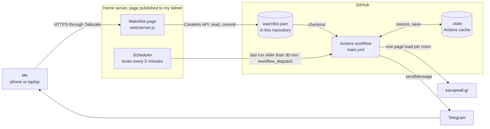
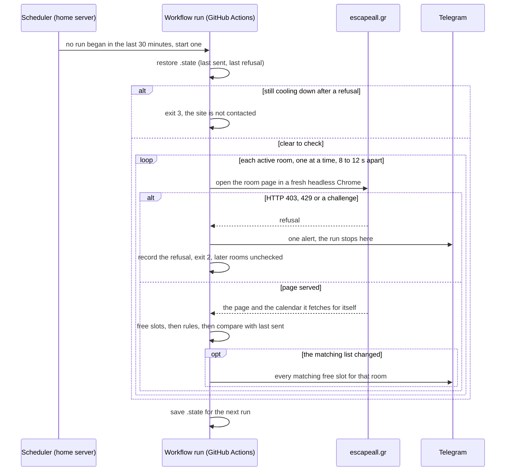

# Escape Room Watcher

[](https://github.com/AthanasiosOikonomou/escape-room-watcher/actions/workflows/main.yml)


Watches a list of escape rooms on [EscapeAll](https://www.escapeall.gr) and sends a Telegram message when a free slot appears on the days and at the hours you could actually play.

It replaces checking each room's booking calendar by hand, room by room and day by day. About every 30 minutes a GitHub Actions workflow opens each room page once, keeps the free slots that match that room's rules, and messages only when the answer has changed. The list of rooms is edited on a small private web page and lives as a JSON file in this repository.

The first badge above is the watcher's own health: it is the result of the latest check, not of a build.

## What it does

- **Checks every room on the watchlist**, today plus the next 14 days, one room at a time.
- **Filters by your rules.** Each room has its own: days of the week, a window of start times, optionally a date range. A room without rules reports every free slot.
- **Messages on change.** When a room's matching free slots differ from the last message, Telegram gets the full current list. When they are all gone, it says so once.
- **Gives the list a page.** Add a room by pasting its link, set its slots, pause it, remove it. Saving is a commit to `watchlist.json`. The page also shows when the last check ran and has a "Check now" button.
- **Treats a refusal as an answer.** If the site answers 403, 429 or a challenge, the run stops, one alert is sent, and nothing contacts the site for an hour.

A message looks like this (Telegram draws each day as a quoted card):

```text
🏠 Antique
Fri, Sat, Sun 19:00–22:00

┃ Fri 20 Nov
┃ 19:00  ·  21:15

┃ Sat 21 Nov
┃ 20:30
```

## How it works



| Part | Runs on | Responsibility | Never does |
|---|---|---|---|
| Watcher (`src/`, `escape_availability.js`) | GitHub Actions runner | Opens room pages, applies rules, sends messages, records refusals | Write to the repository (`permissions: contents: read`) |
| Watchlist page (`web/`) | Home server, loopback only | Edits `watchlist.json` through GitHub's API, starts checks when one is due | Contact escapeall.gr |
| `watchlist.json` | This repository | The single source of truth for rooms and rules | |
| `.state` | Actions cache | What was last sent per room, and the last refusal | |

The two halves share no network path. They meet only in GitHub: the page commits a file and dispatches a workflow; the workflow checks out that file.

## One check, start to finish



Exit codes carry the outcome, so a glance at the Actions tab is enough:

| Code | Meaning | Run shows as |
|---|---|---|
| 0 | Every room checked, every message delivered | green |
| 1 | A room's check failed, or Telegram would not take a message | red |
| 2 | The site refused the request; the run stopped | red |
| 3 | Cooling down after an earlier refusal; nothing was requested | green (the workflow maps 3 to success) |

## Design decisions

### The checks run on GitHub Actions, not on the home server

The home server needs no browser and no `npm install`, and it never talks to the booking site. Every run leaves a log, the Telegram secrets live in GitHub, and a failed run is visible without any monitoring of my own.

*Alternative:* a systemd timer on the server running the watcher directly. Scheduling would be simpler, but it puts a headless Chrome and all the site traffic on a home connection.
*Tradeoff:* GitHub's scheduler becomes part of the system (next decision), and state cannot live on a disk (last decision).

### The home server starts the checks; GitHub's `schedule:` is only the fallback

GitHub documents two properties of scheduled workflows that matter for something meant to run unattended: runs can be delayed under load, and in a public repository schedules are disabled automatically after 60 days without repository activity. So `web/scheduler.js` looks at the workflow's latest run every 5 minutes and dispatches one when none began in the last 30. In practice a run starts 30 to 35 minutes after the previous one began.

The decision is made from GitHub's own run list, not from local memory. Runs started by the cron or by hand count too, so they never pile up, and restarting the service cannot cause an extra run. The workflow's `concurrency` group makes a late run wait instead of overlapping.

*Alternative:* trust the cron (`7,37 * * * *`, still in the workflow).
*Tradeoff:* the cadence now depends on the home server being up. When it is down, the cron is what is left.

### The watchlist is a file in the repository

The workflow gets the list with a plain checkout: no database, no API of my own, nothing for the runner to reach on my network. Every edit is a commit with a message that says what changed (`Watchlist: add Antique; update Scream`), so history and undo come for free. Saves use the file's blob SHA as an optimistic lock: an edit made somewhere else is refused as a conflict instead of being overwritten.

*Alternative:* keep the list on the server and let the workflow fetch it. That needs the server reachable from GitHub's runners; it is deliberately not.
*Tradeoff:* the page has to hold a GitHub token, and because the repository is public, so is the list.

### The watcher reads the calendar the page loads instead of clicking through it

A bookable room page fetches its whole calendar in one request right after it loads. `src/site/calendar.js` listens for that response and reads it; this sends nothing to the site and loads nothing extra. The original approach, clicking each day and reading the list that appears, is kept as the fallback for a payload the parser does not recognise.

The switch was made for correctness, not speed: on 19 November 2026 the click-through lost 3 of 12 days to stale lists.

*Alternative:* calling that endpoint directly, without a browser. Not done: the tool stays at one ordinary page view per room.
*Tradeoff:* a full browser page load per room is still the heaviest thing in a run.

### State lives in the Actions cache

Two small files persist between runs: what was last sent per room, and the last refusal. A cache entry cannot be overwritten, so each run saves under a new key and the next run restores the most recent by prefix.

*Alternative:* commit state to a branch. That would give the workflow write access to the repository and fill the history with machine commits.
*Tradeoff:* GitHub may evict a cache. The watcher is built for that: with no memory it sends the current list again, which is a duplicate message, not a missed slot.

## Slot rules

A room's `rules` decide which free slots are worth a message. A slot is kept when at least one rule accepts it; no rules means every slot.

```json
{
  "version": 1,
  "rooms": [
    {
      "name": "Antique",
      "url": "https://www.escapeall.gr/en/EscapeRoom/Details/antique",
      "paused": false,
      "rules": [
        { "days": ["fri", "sat"], "from": "19:00", "to": "01:00" },
        { "days": ["sun"], "to": "18:00", "dateFrom": "2026-12-20", "dateTo": "2027-01-06" }
      ]
    }
  ]
}
```

| Field | Meaning | When missing |
|---|---|---|
| `days` | Weekdays, `mon` to `sun` | Any day |
| `from`, `to` | Earliest and latest start time, `HH:MM` | No bound on that side |
| `dateFrom`, `dateTo` | Only between these dates, `YYYY-MM-DD` | Any date |

Start times before 06:00 belong to the evening before, because that is how the site lists them: "00:30" under Saturday is the Saturday night session. So `"from": "19:00", "to": "01:00"` means seven in the evening until one at night, and the rule validator accepts it.

The same `src/rules.js` is served to the page, so the browser and the watcher validate and describe rules with one piece of code. Limits: 40 rooms, 10 rules per room, and only `https://www.escapeall.gr/.../EscapeRoom/Details/<room>` URLs.

## Notifications

- **The whole list, on change.** A message carries every matching free slot for the room, not a diff. It is sent when that list differs from the last one sent. `NOTIFY_MODE=always` sends it on every run instead.
- **Gone is news too.** When a room that had matching slots has none left, one short message says so.
- **A message that cannot be delivered fails the run.** The memory of what was sent is only updated after Telegram accepts the message, so the next run sends it again. A rejected bot token therefore shows up as a red run, not as silence.
- **Formatting never costs the content.** If Telegram rejects the formatted message (HTTP 400), the same text is sent plain.

## Being a careful client

This is an unofficial personal tool. It is not affiliated with EscapeAll, and it reads a site that offers no public API for this. It is written to keep its load on that site small and predictable, and to stop when told to:

- **One page view per room per run**, one room at a time, each in a browser that is closed afterwards.
- **A pause between rooms**: 8 seconds plus up to 4 at random, with a floor of 5. The floor exists because ten page loads in about a minute were answered with HTTP 429.
- **A refusal is never retried.** HTTP 403, 429 or a Cloudflare challenge ends the run on the spot. The remaining rooms are left unchecked and one alert says how many.
- **A cool-down follows**: 60 minutes by default, never less than 15, and longer when the site's `Retry-After` asks for longer. It is stored in `.state`, so it holds across runs and for manual runs too.
- **No overlapping or rapid-fire runs.** The workflow's concurrency group queues them, "Check now" is refused within 5 minutes of the last run, and the scheduler cannot be set below 15 minutes.

If you run your own copy, keep these in place and read the site's terms first.

## Technology, and why

| Choice | Why | Tradeoff accepted |
|---|---|---|
| **Node.js ≥ 22.12, ES modules** | One language for the watcher, the page and the tests. Built-in `fetch`, `node:test` and `--env-file` cover what would otherwise be three dependencies. | Newer Node required; the workflow pins 24. |
| **No framework for the page** | Four API routes and five static files. `web/server.js` is 252 lines of `node:http`, so the server deploys with `git pull` and nothing to install. Express was the obvious alternative; for four routes it would add a dependency tree to a service that has none. | Routing, headers and body limits are written by hand, and tested by hand-written tests. |
| **Puppeteer** (the only runtime dependency) | The slots are loaded by the page's own script, so a real browser sees exactly what a visitor sees. | Chrome is the slowest and largest part; the workflow caches it between runs. |
| **GitHub Actions as the runner** | Logs, secrets, a cache and a manual trigger with inputs (`dry_run`, `rooms`), with no machine of mine involved. | Its scheduler cannot be relied on alone. |
| **GitHub Contents API as the datastore** | Versioned, auditable, already where the workflow reads. | A token on the server; a public list. |
| **Telegram Bot API over plain HTTPS** | One POST per message, no SDK. | The bot token is part of the URL, so the URL is never logged. |
| **systemd and Tailscale for the page** | The unit runs as a throwaway user with no privileges; the page listens on loopback and `tailscale serve` publishes it to my devices. Network access is the login. | Anyone on the tailnet can edit the list. |

## Run it yourself

Prerequisites: Node.js 22.12 or newer, a Telegram bot token and chat ID, and your own fork (the workflow, the secrets and the watchlist are per repository).

### Check from your machine

```bash
git clone https://github.com/AthanasiosOikonomou/escape-room-watcher.git
cd escape-room-watcher
npm ci
npx puppeteer browsers install chrome    # npm ci does not download Chrome by itself
npm test                                 # 82 tests against a mock site and a mock GitHub; nothing real is contacted
npm run dry -- --rooms antique           # one real room, nothing sent ("antique" = the end of its URL in watchlist.json)
```

A dry run ends with a line like:

```text
Done in 21 s: 1 with free slots, 0 with nothing free, 0 removed, 0 failed.
```

`npm run dry` without `--rooms` checks every active room; `npm start` does the same and sends messages when `TELEGRAM_TOKEN` and `ONLY_CHAT_ID` are set.

### Checks on GitHub Actions

1. In your fork: **Settings → Secrets and variables → Actions**, add `TELEGRAM_TOKEN` and `ONLY_CHAT_ID`.
2. Put your rooms in `watchlist.json` (or use the page below).
3. **Actions → Escape Room Availability Check → Run workflow**, with *dry_run* ticked for the first try.

### The watchlist page

```bash
cp .env.example .env     # then set GITHUB_TOKEN and GITHUB_REPO in it
npm run web
```

```text
Watchlist page on http://127.0.0.1:8787 (edits watchlist.json in <owner>/<repo>, branch main)
Keeping the checks going: a run of main.yml is started when none began in the last 30 minutes.
```

The token is a fine-grained personal access token limited to this one repository, with **Contents: Read and write** and **Actions: Read and write** and nothing else. Installing the page as a service on a server, step by step: [docs/deploy-watchlist-page.md](docs/deploy-watchlist-page.md).

## Configuration

<details>
<summary>Watcher (environment variables and workflow secrets)</summary>

| Variable | Default | Purpose |
|---|---|---|
| `TELEGRAM_TOKEN` | none | Bot token. Secret. Without it nothing is sent and the run still succeeds. |
| `ONLY_CHAT_ID` | none | The chat that receives the messages. Secret. |
| `WATCHLIST_FILE` | `watchlist.json` | The list to read. |
| `NOTIFY_MODE` | `on-change` | `on-change` or `always`. |
| `STATE_DIR` | `.state` | Where the last-sent memory and the last refusal are kept. |
| `PAUSE_BETWEEN_ROOMS_MS` | `8000` | Pause between two rooms; 5000 to 600000. |
| `PAUSE_RANDOM_EXTRA_MS` | `4000` | Random extra on top of it. |
| `REFUSAL_COOLDOWN_MINUTES` | `60` | Silence after a refusal; 15 to 1440. |
| `DAYS_AHEAD` | `14` | How many days after today are reported. |
| `DRY_RUN` | `false` | Same as `--dry-run`: check, send nothing, leave the memory alone. |
| `ONLY_ROOMS` | empty | Same as `--rooms a,b`: only these rooms, by the end of their URL. |

Command line: `--dry-run`, `--rooms a,b`, `--report out.json` (the full result of the run as JSON).

</details>

<details>
<summary>Watchlist page (<code>.env</code>, or <code>/etc/escape-room-watchlist.env</code> on a server)</summary>

| Variable | Default | Purpose |
|---|---|---|
| `GITHUB_TOKEN` | required | Fine-grained token for this repository only. Secret; never logged, never returned by the API. |
| `GITHUB_REPO` | required | `owner/repository`. |
| `GITHUB_BRANCH` | `main` | Branch the list is read from and committed to, and the workflow is started on. |
| `WATCHLIST_PATH` | `watchlist.json` | The file inside the repository. |
| `WORKFLOW_FILE` | `main.yml` | The workflow to watch and start. |
| `CHECK_EVERY_MINUTES` | `30` | Start a check when none began within this long. `0` leaves it to GitHub's schedule; otherwise 15 to 720. |
| `HOST` | `127.0.0.1` | Loopback by default. Publish with `tailscale serve` rather than by opening the port. |
| `PORT` | `8787` | |
| `ALLOWED_HOSTS` | empty | Extra host names the page may be opened under. `localhost` and `*.ts.net` are always accepted. |

</details>

## Project structure

```text
.
├── escape_availability.js       how one room is checked (Puppeteer); the only file that opens the site
├── watchlist.json               rooms and rules: written by the page, read by the watcher
├── src/
│   ├── cli.js                   entry point: arguments, cool-down, state, exit codes
│   ├── watcher.js               one run: room by room, rules, what to send, the report
│   ├── rules.js                 slot rules; also served to the page
│   ├── watchlist.js             validation: EscapeAll room pages only
│   ├── cooldown.js              the silence after a refusal
│   ├── config.js                watcher settings
│   ├── site/calendar.js         reads the calendar response the page fetched
│   ├── site/refusal.js          tells a refusal, a removed room and a served page apart
│   └── notify/                  telegram.js (messages, delivery), memory.js (what was last sent)
├── web/                         the watchlist page: no dependencies, never contacts the site
│   ├── server.js                routes, headers, host and origin checks
│   ├── github.js                the only place the GitHub token is used
│   ├── scheduler.js             starts a check when one is due
│   └── public/                  the page: index.html, app.js, styles.css
├── test/                        node:test; helpers/ holds a mock EscapeAll site and a mock GitHub API
├── deploy/                      systemd unit for the page
├── docs/                        deploy guide for the page
└── .github/workflows/main.yml   the check: on demand, and on GitHub's schedule as fallback
```

## Security

The threat model is small and stated plainly: one user, a page that is not on the public internet, and two secrets (a GitHub token and a Telegram bot token).

- **The GitHub token can do two things in one repository.** Contents and Actions, read and write, on this repository only. On a server it sits in a root-owned file with mode 600. `web/github.js` is the only module that touches it; errors carry the HTTP status and GitHub's message, never the token, and the tests assert that.
- **The workflow cannot write to the repository** (`permissions: contents: read`), and the Telegram secrets exist only as Actions secrets.
- **The page is unreachable from outside by default.** It listens on loopback; Tailscale publishes it to the tailnet.
- **The page is hard to reach by trickery.** Requests under an unknown `Host` are turned away, which stops DNS rebinding. Changes must carry an `Origin` matching the page itself. The content policy is `default-src 'none'` with same-origin scripts and styles only. Five named files are served and nothing else on disk.
- **The watchlist cannot aim the browser elsewhere.** Both the page and the watcher refuse any URL that is not an `https` EscapeAll room page, so a bad edit, by hand or otherwise, cannot send a headless browser to another site.
- **The service runs with nothing.** The systemd unit uses `DynamicUser`, an empty capability set, a read-only file system and no access to home directories or devices.

What this does not have: a login. Whoever can reach the page can edit the list, so the network is the access control.

## Testing

```bash
npm test
```

82 tests on Node's built-in runner, with no test dependencies. The parts that matter are tested against stand-ins rather than mocks of my own functions:

- **A mock EscapeAll site** serves room pages, calendars, refusals and removed rooms, and the real room check drives a real headless Chrome against it.
- **A mock GitHub API** stands in for Contents and Actions, including conflicts, refused tokens and a missing file.
- **The page is tested in a browser**: adding a room, the slots dialog, search, pause and undo, a conflicting edit made elsewhere, and room names rendered as text, never as markup.

Tests read as statements of behaviour, for example *"a refusal stops the run at once: no retry, later rooms untouched, one alert"* and *"looking again right after starting a run does not start another: restarts cannot pile up runs"*.

The tests run locally, not in CI, and coverage is not measured.

## Lessons learned

- **"Nothing free" and "we were refused" looked identical.** A blocked page has no calendar, and an empty calendar reads as no availability. Reading the HTTP status of the page load and treating a refusal as its own outcome is what lets silence mean "nothing free".
- **Clicking through a calendar is lossy.** After each click the watcher has to decide whether the list on screen is the new day's or left over from the last one, and it got that wrong: 3 of 12 days were dropped as stale in one run. Reading the one response the page already receives avoids the question, and the click-through survives only as a fallback.
- **A green run that sent nothing is the worst outcome.** Delivery failures used to be logged and forgotten. Now an undelivered message fails the run and is retried on the next one.
- **Pace has a floor.** Ten page loads in about a minute were answered with HTTP 429. The minimum pause between rooms is a validated setting, not a suggestion.
- **Cache entries are immutable.** State kept in the Actions cache needs a new key per run and a prefix restore, and the code has to be correct when the cache is simply gone.

## Known limitations

- **One site, and its internals.** The watcher depends on EscapeAll's page markup and the shape of its calendar response. A change there breaks it until the parser is updated.
- **Not real time.** A slot can appear and be booked between two checks, or be gone by the time the message is read.
- **The site can refuse it at any time**, and then nothing is checked for at least an hour.
- **Rooms without an online calendar report nothing.** They are best paused.
- **One user, one Telegram chat, no login on the page.**
- **The cadence depends on the home server.** Without it, GitHub's schedule is the only trigger.
- **No CI for the tests** and no measured coverage.

## License

[ISC](LICENSE)
